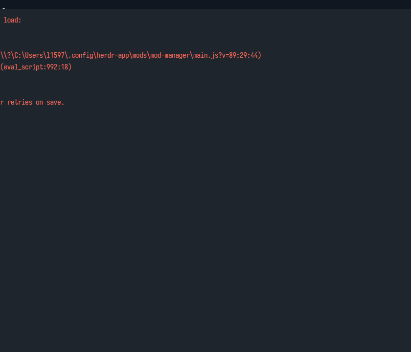

# Herdr Mod Manager

A beautiful, standalone visual mod & overlay manager for the **[Herdr app](https://github.com/herdr/herdr-app)**.



## 🌟 Features

- **🪟 Standalone Window Overlay**: Opens cleanly as a draggable, floating window without dimming or disrupting your workspace.
- **⚡ Interactive Switches**: Elegant iOS/macOS-styled toggle switches to quickly enable or deactivate mods.
- **🔄 Instant Layout Hot-Swapping**: Automatically detects slots (like `files`, `changes`, `spaces`, `chrome`, `status`) and swaps custom mods in and out of your active layout without manual JSON editing.
- **📦 Package Isolation (`mods/` ⇄ `mods-disabled/`)**: Safely disable custom mods by isolating them into `mods-disabled/` and restore them anytime with a single click.
- **📑 Filter Tabs & Instant Search**: Filter by **All**, **In Active Layout**, **Custom**, **Disabled**, and **Shipped** mods, with instant full-text search across titles, descriptions, and file paths.
- **📋 Shipped Mod Duplication**: Shipped mods in Herdr are read-only; duplicate any mod with a custom name to begin editing your own version.
- **🔄 Rotating Refresh**: Dedicated icon button to instantly re-scan the mods directories.

---

## 🚀 Installation

### Automated Install (Recommended)

#### Windows (PowerShell)
```powershell
git clone https://github.com/s16777216/herdr-mod-manager.git
cd herdr-mod-manager
.\install.ps1
```

#### macOS / Linux (Bash)
```bash
git clone https://github.com/s16777216/herdr-mod-manager.git
cd herdr-mod-manager
./install.sh
```

### Manual Install
Copy the `mods/mod-manager` folder directly into your Herdr configuration directory:

- **Windows**: `%USERPROFILE%\.config\herdr-app\mods\mod-manager`
- **macOS / Linux**: `~/.config/herdr-app/mods/mod-manager`

Verify installation:
```bash
herdr-app check ~/.config/herdr-app/mods/mod-manager
```

---

## 🎮 How to Open

### 1. From Command Line or Terminal
```bash
herdr-app do mod.open --name mod-manager
```

### 2. Via Keyboard Shortcut
Add a hotkey to your `~/.config/herdr-app/keys.json`:
```json
{
  "global": {
    "ctrl-shift-m": "mod.open:mod-manager"
  }
}
```

### 3. Add to Sidebar (e.g. in your custom workspace-chrome mod)
In your sidebar mod (such as `mods/my-workspace-chrome/main.js`):
```javascript
import { run } from "herdr";

// Add a button that calls:
run("mod.open", { name: "mod-manager" });
```

---

## 🛠️ Mod Structure

```
herdr-mod-manager/
├── install.ps1          # Windows installer
├── install.sh           # macOS / Linux installer
├── preview.png          # Visual preview
├── README.md
└── mods/
    └── mod-manager/
        ├── main.js      # Mod Manager standalone View
        ├── mod.json     # Overlay window definition
        ├── layers.svg   # Window icon
        └── refresh.svg  # Refresh icon
```

---

## 📄 License
MIT License. Feel free to use, modify, and distribute!
