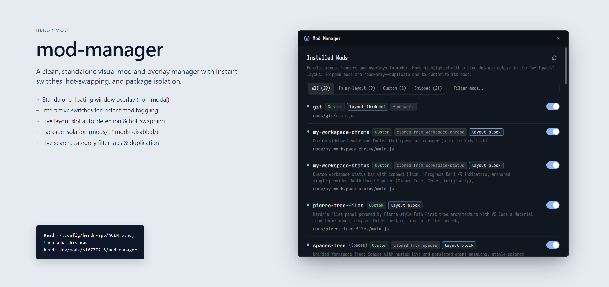

# Mod Manager

A clean, standalone visual mod and overlay manager for the Herdr app. It opens as a dedicated floating window, presents all installed, shipped, and disabled mods with live status dots and badges, allows instant iOS-style switch toggling for active layout slots and package isolation, provides real-time search and filter tabs, and duplicates shipped mods for customization with a single click.

## What you see

The mod opens as an overlay window (`kind: "window"`, width 740px, height 620px) centered over the workspace, rendered inside a rounded-10 bordered container with `theme().border` (1px) and `theme().background`. From top to bottom:

1. **Window Title Bar** (42px high, px 16, background `theme().chrome`, bottom border in `theme().border`):
   - Left: 16px `layers.svg` icon in `theme().accent` and "Mod Manager" title (14px font semibold, `theme().foreground`).
   - Right: 24×24px rounded close button ("×", 16px text, hover `theme().hover`, tooltip "Close (Esc)").
2. **Main Scrollable Content Body** (flex-1, min-h 0, `overflow_y_scroll`, with full-height vertical scrollbar):
   - **Header & Refresh Row** (pt 18, pb 4):
     - Title: "Installed Mods" (16px font semibold, `theme().foreground`).
     - Right: 28×28px rounded icon button with 14px `refresh.svg` glyph (`theme().muted`, hover `theme().foreground`), spins smoothly with a 900ms transition during scanning.
   - **Subtitle**: 12.5px text in `theme().dim` explaining active layout indicators and shipped mod read-only duplication.
   - **Notice Banner** (shown when actions complete):
     - `theme().raised` pill background, 1px `theme().border`, green/amber status text in `theme().ansi2`, and a right-aligned "Dismiss" button.
   - **Search & Filter Controls** (h-flex, pb 10, gap 8, items-center):
     - Filter tabs pill strip: grouped tabs for **All**, **In <layout>**, **Custom**, **Disabled** (if any exist), and **Shipped**. Selected tab highlighted with `theme().raised` and border.
     - Search input: 24px high text input box (`InputState.new({ placeholder: "Filter mods…" })`) with real-time text matching.
   - **Mod Rows** (each row py 12, gap 6, bottom border in `theme().border`):
     - **Status Indicator**: 7×7px rounded dot on the left (blue `theme().accent` for active in current layout, green `theme().ansi2` for custom enabled, dim `theme().dim` for shipped or disabled).
     - **Mod Info**:
       - Name: 13.5px font semibold in monospace font (`DEFAULT_FONT`), optional custom title in parentheses.
       - Badges: 11px compact pills for `Shipped`, `Custom`, `Disabled`, active slot role (e.g. `layout block`, `open pane`), `overlay`, or `dock`.
       - Description: 12.5px line-height 18px text in `theme().dim` extracted from header comments or fallback directory descriptions.
       - Path: 11.5px monospace text in `theme().muted` showing `mods/<name>/main.js`.
     - **Controls**:
       - iOS-style capsule Switch (36×20px, rounded 10, white 16×16px circular thumb):
         - For layout slot mods: toggles active state in the current layout JSON.
         - For non-slot custom mods: toggles between `mods/` and `mods-disabled/` for complete package isolation.
         - For disabled mods: click to restore to `mods/`.
       - `Open` button: for overlays and dialogs, closes Mod Manager and immediately opens the target overlay.

## How it behaves

- **Opening & Closing**: Opened via `run("mod.open", { name: "mod-manager" })` or keyboard shortcut. Pressing `Escape` or clicking the "×" title button closes the overlay smoothly.
- **Mod Directory Scanning**: On launch or refresh click, reads `installed.json` to identify shipped mods, scans `~/.config/herdr-app/mods/` and `~/.config/herdr-app/mods-disabled/`, and extracts inline comment headers for human descriptions.
- **Layout Slot Resolution**: Inspects the active `layout()` tree and open `panes()` to map which mods occupy standard UI slots (`files`, `changes`, `spaces`, `chrome`, `status`).
- **Interactive Switching**:
  - Toggling an active custom slot mod replaces it with the shipped default in the layout JSON.
  - Toggling an inactive custom slot mod hot-swaps it into the layout JSON.
  - Toggling an unslotted custom mod safely moves its folder between `mods/<name>` and `mods-disabled/<name>`.
- **Search & Filtering**: Real-time filtering updates the list without blocking typing; filtering queries match against name, title, description, and slot role.

## Built from

- **GPUI Elements**: `v_flex`, `h_flex`, `div`, `svg`, `Input`, `InputState`, `Scrollbar`.
- **Herdr APIs**: `theme`, `layout`, `panes`, `shared`, `appHome`, `readTextFile`, `run`, `closeOverlay`, `props`.
- **Node APIs**: `import * as fs from "fs/promises"`.
- **Art**: `layers.svg`, `refresh.svg`.

## Watch out

- **GPUI View Lifecycle**: GPUI Views must initialize state inside `init(_props, cx)` using `cx.focus_handle()`; do not use ES6 `constructor()` without context.
- **InputState API**: In `gpui-base`, instantiate with `InputState.new({ placeholder: "..." })` and attach change listeners with `input.on("change", ...)`.
- **Windows Path Handling**: Herdr uses forward slashes internally for configuration paths; ensure paths are properly concatenated with `${appHome()}/mods/...`.
- **Read-Only Shipped Layouts**: Herdr's built-in layouts (`main`, `terminals`, `win98`) are read-only. Attempting to hot-swap slots on a shipped layout warns the user to duplicate the layout first.

## Done when

1. `herdr-app check mods/mod-manager` exits with code 0.
2. `herdr-app do mod.open --name mod-manager` displays the 740×620px window centered.
3. Clicking the refresh icon smoothly spins and updates mod counts.
4. Typing in the search input filters rows in real time.
5. Toggling a supported custom slot mod updates the active layout without errors.
6. Pressing `Esc` or clicking "×" cleanly closes the window.
